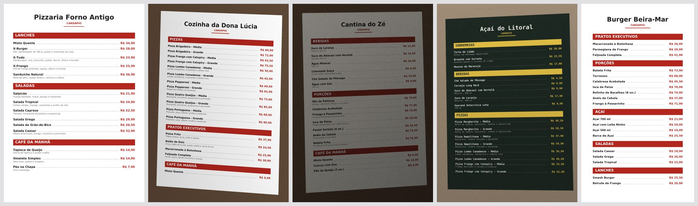
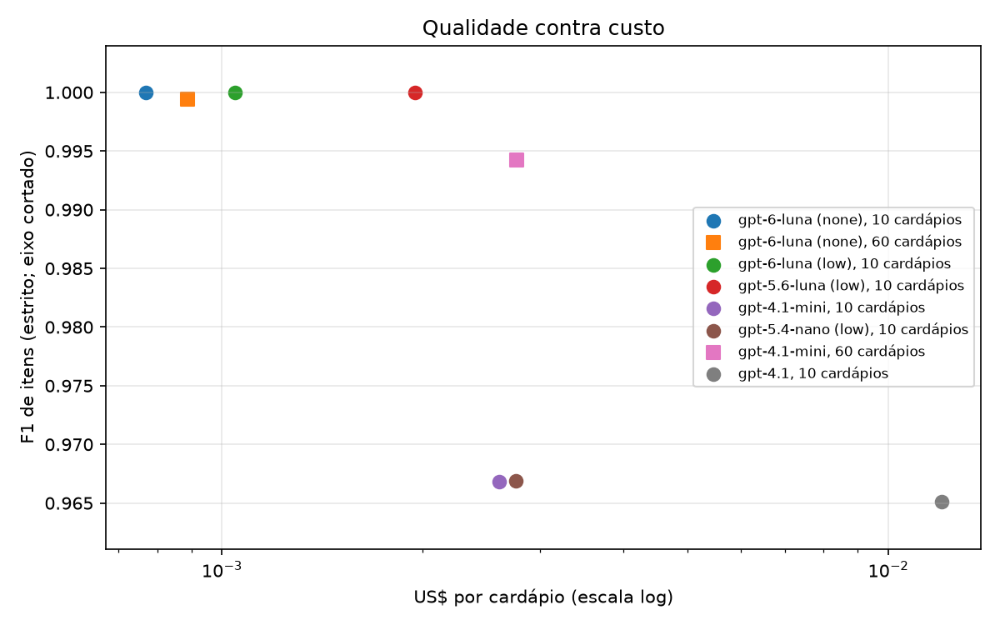

# menu-reader-lab

Laboratório para medir **qualidade, custo e latência** de leitores de cardápio por IA, na nuvem e no computador local, em cardápios sintéticos com gabarito.

A pergunta que guia o projeto: **qual é a leitura mais barata que ainda passa na conferência?** Ler um cardápio a partir de fotos ou PDF é uma tarefa comum em plataformas de delivery e PDV (o lojista envia o cardápio e a IA monta o cadastro). Quase ninguém mede quanto esse leitor acerta e quanto custa, e a escolha de provedor e de modelo costuma ser um palpite.



## Estado

Projeto no **Dia 1**, com duas rodadas reais feitas (7 modelos da OpenAI em 10 cardápios; 2 deles nos 60). O que existe e o que não existe:

| | Estado |
|---|---|
| Gerador de cardápios sintéticos com gabarito (10 estilos, PDF e imagem) | feito |
| Avaliador (itens, preço, categoria, itens inventados, JSON válido) | feito e validado com leitores de ruído conhecido |
| Custo em dólar por leitura, com tabela de preços versionada e fonte | feito |
| Teto de gasto obrigatório em leitor pago | feito |
| Leitor da OpenAI (a régua) | feito e executado contra a API real em 7 modelos (ver [Resultados reais](#resultados-reais)) |
| Varredura de vários modelos sob um teto total de gasto (`sweep`) | feito |
| Reavaliar execuções salvas sem chamar a API (`rescore`) | feito |
| Leitores da Anthropic e do Gemini | não feito |
| Alavancas de otimização | "modelo menor" **medido**; reduzir a foto e texto do PDF **implementados e testados, ainda sem medir com a API**; cache e saída compacta não feitos |
| Modelos de visão locais, OCR local e cascata | não feito |
| Cardápios reais | não feito (ficam no privado, com autorização de cada lojista) |

Os resultados reais cobrem **7 modelos em 10 cardápios (243 itens) e 2 modelos nos 60 (1.561 itens), só OpenAI e só sintético**. Dá para ver o custo e o tipo de erro de cada um, mas não para cravar ranking entre modelos parecidos; ver as limitações abaixo.

## Como funciona

```
gerar cardápios  →  leitor (arquivos → JSON)  →  avaliador (JSON × gabarito)  →  relatório
  com gabarito       oracle · noisy · openai       itens, preço, categoria,        tabela e gráfico
                                                   inventado, custo, latência
```

Todo leitor recebe os arquivos (fotos ou PDF) e devolve o mesmo JSON, no mesmo schema. Assim qualquer leitor é avaliado do mesmo jeito.

```json
{
  "sections": [{"title": "Lanches", "itemCount": 2}],
  "categories": [{"name": "Lanches", "products": [
    {"name": "X-Burger", "description": "Pão, hambúrguer e queijo", "price": 28.0}
  ]}]
}
```

O inventário `sections` (cada seção e quantos itens ela tem) deixa o servidor conferir se o modelo leu tudo, mas gasta tokens de saída. Ele é opcional (`--no-inventory`) justamente para medir quanto custa e quanto ajuda.

## O conjunto sintético

60 cardápios com semente fixa (`--seed 7`), 1.561 itens e 99 arquivos (75 MB, não versionados: o gerador os recria em ~30 s). Cada estilo testa uma dificuldade diferente:

| Estilo | O que testa |
|---|---|
| `pdf_digital_clean`, `pdf_digital_2col` | PDF com **texto digital** (dá para ler sem visão), uma e duas colunas |
| `pdf_scan` | PDF só de imagem, com inclinação e granulação |
| `photo_straight` | foto com perspectiva, rotação e sombra |
| `photo_lowlight` | pouca luz e ruído alto |
| `photo_blur` | desfoque e duas colunas |
| `photo_2col_serif` | fonte com serifa, duas colunas, categoria que continua na outra coluna sem título |
| `chalkboard` | texto claro em fundo escuro, fonte monoespaçada |
| `screenshot_compact` | captura de tela pequena, sem descrições |
| `photo_multipage` | o mesmo cardápio em várias fotos |

Os preços aparecem em formatos diferentes (`R$ 24,90`, `24,90`, `R$24,90`), e as pizzas têm versões por tamanho que viram produtos separados.

## Como o avaliador mede

- **Casamento de itens:** pelo nome, sem acento, caixa ou pontuação, com tolerância a erro de leitura (similaridade ≥ 88 em `token_sort_ratio`). Os pares mais parecidos casam primeiro, então "Pizza Margherita - Média" nunca vira "Pizza Margherita - Grande".
- **Itens inventados:** item lido sem par no gabarito, ou duplicado. `inventado = FP / (TP + FP)`.
- **Itens perdidos:** item do gabarito sem par. Entram na revocação.
- **Preço certo:** entre os itens casados, preço dentro de meio centavo.
- **Categoria certa:** entre os itens casados, categoria parecida (≥ 80).
- **JSON válido:** conformidade com o schema estrito. Um JSON inválido ainda é pontuado, mas conta contra o leitor.
- **Custo:** tokens × preço de `src/menu_reader_lab/pricing.json`. Modelo sem preço na tabela vira "n/d", nunca um valor inventado.

As métricas somam os acertos de todos os cardápios antes de dividir (micro). Dá para ver também por estilo.

### Dois modos de casar: estrito e tolerante

O modo **estrito** compara só o nome. Na primeira rodada real, vários modelos escreveram "Água Mineral 500 ml" onde o gabarito tem o nome "Água Mineral" e a descrição "500 ml". É a mesma informação escrita de outro jeito, mas o estrito conta isso como um item inventado **e** um item perdido ao mesmo tempo.

O modo **tolerante** aceita o nome lido que absorveu a descrição do gabarito. **Ele foi criado depois de ver os primeiros resultados reais**, para separar o que é jeito de escrever do que é erro de leitura. Por isso as duas métricas aparecem sempre juntas (`F1 de itens` e `F1 tolerante`), e o tolerante nunca fica abaixo do estrito. Com o leitor `noisy`, que não cola descrição ao nome, as duas dão o mesmo número, e o `oracle` dá 1,0000 nas duas.

## Validação do avaliador

Antes de medir qualquer modelo, o avaliador foi testado com leitores de custo zero, e as notas têm que acompanhar o que foi aplicado:

| Leitor | O que faz | F1 de itens | Revocação | Preço certo | Inventado |
|---|---|---|---|---|---|
| `oracle` | devolve o gabarito | 1,0000 | 1,0000 | 1,0000 | 0,0000 |
| `noisy` 10% | perde 10% dos itens, erra 10% dos preços, renomeia 5%, inventa 5% | 0,8787 | 0,8584 | 0,9037 | 0,1001 |
| `noisy` 30% | perde 30%, erra 30%, renomeia 15%, inventa 15% | 0,6557 | 0,5894 | 0,7076 | 0,2610 |

Com 10% de ruído, a revocação esperada é perto de 0,86 (10% perdidos mais ~5% renomeados) e o inventado perto de 0,10: bate. Os 57 testes automatizados cobrem isso, o gerador, o cálculo de custo, o formato do pedido à OpenAI, o teto de gasto, a varredura, o casamento tolerante, a reavaliação e as duas alavancas de preparo (foto reduzida e texto do PDF).

## Resultados reais

Só a OpenAI foi medida até aqui, e só em cardápios sintéticos. Gasto total das duas rodadas: **US$ 0,43**.

### Os 60 cardápios (1.561 itens), dois modelos

Os dois modelos que melhor se saíram na rodada pequena (abaixo) leram o conjunto inteiro, com `detail=high` e o inventário `sections`, sob teto de US$ 0,50 (gastaram US$ 0,22). A régua `gpt-4.1` **não** rodou nos 60 (custaria ~US$ 0,72, e não foi aprovado esse gasto): a comparação direta com ela está só no subconjunto de 10 cardápios mais abaixo.

| Modelo | F1 estrito | F1 tolerante | Preço certo | Categoria certa | Cardápios sem nenhum erro | Tokens por cardápio: entrada / saída | US$ por cardápio | Mediana / p95 |
|---|---|---|---|---|---|---|---|---|
| `gpt-6-luna`, sem raciocínio | 0,9994 | 0,9994 | 0,9987 | 0,9968 | 55 de 60 | 5.048 / 769 | 0,00089 | 7,0 s / 11,7 s |
| `gpt-4.1-mini` | 0,9942 | 0,9968 | 0,9961 | 0,9955 | 51 de 60 (estrito: 49) | 3.985 / 736 | 0,00277 | 8,6 s / 13,0 s |

- **`gpt-6-luna`: 1.560 de 1.561 itens casados.** Sobrou 1 item a mais ("Bolo Caseiro", numa foto desfocada) e faltou 1 ("Tapioca de Queijo"). Os outros dois erros são **dois preços trocados entre itens vizinhos** num quadro-negro (Açaí Fit com 29,50 em vez de 30,99, e o contrário). Custo total para ler os 60: US$ 0,053.
- **`gpt-4.1-mini`: 9 itens perdidos e 1 a mais na métrica tolerante.** Perdeu 4 itens de um PDF de duas colunas, 3 numa foto desfocada e 1 em outra; escreveu "Galinahd" no lugar de "Galinhada" num PDF escaneado. Errou 6 preços, em dois cardápios (pouca luz e várias fotos), quase todos por **troca de preço entre itens vizinhos**. Custou 3,1× o `gpt-6-luna`.
- **Os erros dos dois são do mesmo tipo:** item vizinho trocado, texto desfocado ou coluna perdida. Nenhum devolveu JSON inválido nem falhou na chamada (0 erros em 120 leituras).
- **A rodada pequena foi pessimista para o `gpt-4.1-mini`:** nos 10 cardápios ele tirou 0,9668 estrito, nos 60 tirou 0,9942. Os 10 primeiros são os mesmos cardápios dos 60 (incluem o PDF de duas colunas e a foto desfocada, que são os mais difíceis), então não são uma amostra independente.
- **O que isso ainda não prova:** é um conjunto sintético de uma única semente, fonte limpa, uma só família de modelos. A diferença entre os dois (2 contra 10 erros de item em 1.561) é pequena em número absoluto, embora vá na mesma direção da rodada de 10 cardápios.

### Sete modelos em 10 cardápios (243 itens)

Cardápios sintéticos (semente 7), os 10 primeiros, **um de cada estilo**, 243 itens. Todos com `detail=high` e o inventário `sections`. Gasto desta rodada: **US$ 0,21** (teto de US$ 1 para a régua e de US$ 0,50 para a varredura). F1 e preço são os do modo estrito, o F1 tolerante vem ao lado. Preços de 01/11/2026, em [`pricing.json`](src/menu_reader_lab/pricing.json).

| Modelo | F1 estrito | F1 tolerante | Preço certo | Tokens por cardápio: entrada / saída (raciocínio) | US$ por cardápio | Mediana |
|---|---|---|---|---|---|---|
| `gpt-6-luna`, sem raciocínio | 1,0000 | 1,0000 | 1,0000 | 4.765 / 696 | 0,00077 | 5,8 s |
| `gpt-6-luna`, raciocínio `low` | 1,0000 | 1,0000 | 1,0000 | 4.765 / 1.138 (145) | 0,00105 | 11,8 s |
| `gpt-5.6-luna`, raciocínio `low` | 1,0000 | 1,0000 | 1,0000 | 4.765 / 830 (140) | 0,00195 | 7,7 s |
| `gpt-4.1-mini` | 0,9668 | 0,9917 | 1,0000 | 3.796 / 681 | 0,00261 | 7,2 s |
| `gpt-5.4-nano`, raciocínio `low` | 0,9669 | 0,9917 | 0,9701 | 4.353 / 1.511 (686) | 0,00276 | 10,6 s |
| `gpt-4.1` (a régua) | 0,9651 | 0,9856 | 0,9957 | 1.908 / 1.025 | 0,01202 | 6,5 s |
| `gpt-4.1-nano` | n/d | n/d | n/d | n/d | n/d | a API respondeu 404: modelo descontinuado, embora a página de preços ainda o liste |



Círculo: execução de 10 cardápios. Quadrado: execução dos 60. O eixo vertical é cortado, então a distância entre os pontos parece maior do que é.

Tabela completa, com precisão, revocação e latência p95: [`docs/results.md`](docs/results.md).

O que os números mostram, e o que não mostram:

- **`gpt-6-luna` leu os 243 itens, com preço e categoria certos, por cerca de 1/15 do custo da régua `gpt-4.1`** (US$ 0,00077 contra US$ 0,01202 por cardápio). Isso é verdade para este conjunto sintético; não é prova de que lê cardápio real com a mesma nota.
- **Raciocínio não ajudou aqui.** No `gpt-6-luna`, o esforço `low` deu a mesma nota com 36% mais custo e o dobro da latência. Os tokens de raciocínio são cobrados como saída.
- **Nos modelos baratos o custo é entrada, não saída.** Os `luna` gastam ~4.800 tokens de entrada por cardápio contra ~1.900 do `gpt-4.1` (pela documentação da OpenAI, a imagem é contada em blocos de 32 px nos modelos novos e em blocos de 512 px no `gpt-4.1`). No `gpt-4.1`, a saída pesa ~68% do custo. Por isso a alavanca seguinte é o tamanho da imagem enviada, não o tamanho do JSON.
- **Os erros que sobraram são reais, e diferentes por modelo.** `gpt-4.1`: leu 69,99 como 69,9, perdeu "Sorvete (2 bolas)", repetiu duas pizzas num cardápio de duas fotos e acrescentou "500 ml" ao nome de duas bebidas cujo gabarito não tem descrição. `gpt-4.1-mini`: perdeu 4 itens de um PDF de duas colunas. `gpt-5.4-nano`: errou ou deixou de ler 7 preços (PDF, pouca luz, quadro-negro, captura de tela), por exemplo 37,00 lido como 3,00, e leu "Torr ermo" no lugar de "Torresmo".
- **Não dá para ranquear `gpt-4.1`, `gpt-4.1-mini` e `gpt-5.4-nano` com isso.** A diferença entre eles é de 3 a 4 itens em 243, com um cardápio de cada estilo. Quem tirou 1,0000 também não está provado perfeito: com 243 itens, zero erro é compatível com uma taxa de erro real de até cerca de 1,2% (regra dos três, 95%).

Reproduzir sem gastar nada: `uv run menu-lab rescore && uv run menu-lab report` refaz as notas a partir das leituras salvas em `runs/`. Essas leituras (`menus.jsonl`) não são versionadas, só os `summary.json`.

## Como usar

Pré-requisito: [uv](https://docs.astral.sh/uv/).

```bash
# 1. gerar o conjunto
uv run menu-lab generate --n 60 --seed 7

# 2. leitores sem custo, para conferir a esteira
uv run menu-lab run --reader oracle --run-id sanity-oracle
uv run menu-lab run --reader noisy --noise 0.1 --run-id sanity-noise-10

# 3. leitor pago (exige chave e teto de gasto)
export OPENAI_API_KEY=...   # nunca grave a chave no código nem no Git
uv run --extra openai menu-lab run --reader openai --model gpt-4.1 --detail high \
    --max-usd 2 --limit 10 --run-id openai-gpt-4.1-high

# 4. vários modelos de uma vez, dividindo um teto total (modelo ou modelo:esforço)
uv run --extra openai menu-lab sweep --models gpt-6-luna:none gpt-6-luna:low gpt-4.1-mini \
    --max-usd-total 0.50 --max-usd-each 0.12 --limit 10

# 5. alavancas de custo (o efeito em qualidade só se sabe medindo, sob teto de gasto)
uv run --extra openai menu-lab run --reader openai --model gpt-6-luna --reasoning-effort none \
    --max-side 1568 --pdf-text --max-usd 0.10 --run-id openai-gpt-6-luna-lado1568-pdftexto

# 6. refazer as notas com o avaliador atual, sem chamar a API, e montar o relatório
uv run menu-lab rescore
uv run menu-lab report
```

Modelo de raciocínio aceita `--reasoning-effort` (`none`, `low`, `medium`...). Uma execução que falha 4 vezes seguidas sem gastar nenhum token (modelo descontinuado, por exemplo) é abortada.

### Teto de gasto

Leitor pago **não roda sem `--max-usd`** e não roda com modelo que não tenha preço na tabela (sem preço não há como impor o teto). O teto é checado **antes** de cada chamada: o gasto acumulado mais o custo médio das leituras anteriores não pode passar do limite. Só a primeira leitura não tem estimativa, então se ela sozinha custar mais que o teto, ele é furado. Comece com `--limit` pequeno.

### Preços

`pricing.json` guarda o preço por milhão de tokens, a data da consulta e o link de cada fonte. Preços mudam (o Gemini tem reajuste agendado para 30/11/2026 e 31/12/2026): reconfira antes de tirar conclusões de custo.

## O plano: cinco caminhos para ler um cardápio

O laboratório existe para comparar estes caminhos com o mesmo gabarito e as mesmas métricas. **Só o A e parte do B foram medidos até aqui** (e só com a OpenAI).

| | Caminho | Em uma linha | Onde roda | Estado |
|---|---|---|---|---|
| A | VLM na nuvem, direto | modelo de visão recebe as fotos ou o PDF e devolve o JSON. É a **régua** | nuvem | medido (OpenAI) |
| B | VLM na nuvem, otimizado | reduz a imagem, usa o texto do PDF, cache de prompt, modelo menor, saída compacta | nuvem | só "modelo menor" foi medido |
| C | OCR local + LLM só de texto | o OCR lê a imagem de graça e o LLM recebe **texto**, sem imagem | OCR local, LLM na nuvem ou local | não feito |
| D | VLM local ponta a ponta | um modelo de visão leve lê a foto na máquina, zero token pago | local | não feito |
| E | **Cascata** | tenta o local, confere o resultado e só chama a nuvem se a conferência falhar | local primeiro | não feito |

A cascata (E) é a parte que mais interessa: a conferência pode usar sinais baratos, como JSON inválido, contagem de itens divergente do inventário `sections`, preço que não vira número, categoria vazia e baixa confiança do OCR.

## Onde está o dinheiro

**Tokens por imagem, segundo a documentação dos provedores (lida em 01/11/2026; muda, confira):**

- **Anthropic:** `⌈largura/28⌉ × ⌈altura/28⌉`, no máximo 1.568 tokens nos modelos padrão e 4.784 nos 4.7 em diante. A documentação recomenda reduzir a imagem antes de enviar quando não precisa de tanta fidelidade.
- **OpenAI, `gpt-4.1`:** `85 + 170 × blocos` de 512 px, depois de caber em 2048×2048 e com o menor lado em 768; `detail: low` custa 85 tokens. Os modelos novos contam por blocos de 32 px com multiplicador 1,2 (até 2.500 blocos no `high`, ou seja, até 3.000 tokens).
- **Gemini:** `media_resolution` define o custo por imagem (`low` 280, `medium` 560, `high` 1.120 tokens). Para PDF, a documentação diz que `medium` já traz o texto nativo e que `high` raramente melhora o OCR.

**Medido aqui (10 cardápios):** no `gpt-4.1` a saída (o JSON escrito) é ~68% do custo; nos modelos novos e baratos a **entrada** domina, porque a imagem vira ~4.800 tokens. Por isso a ordem das alavancas muda conforme o modelo.

Preços por milhão de tokens estão em [`pricing.json`](src/menu_reader_lab/pricing.json), com a data e o link de cada fonte.

## Alavancas de otimização

| # | Alavanca | O que mede | Estado |
|---|---|---|---|
| 1 | **Saída compacta:** chaves curtas, sem campos opcionais vazios, formato por linha | tokens de saída por item | não medida |
| 2 | **Modelo menor** | F1 de itens contra a régua | medida só na OpenAI |
| 3 | **Reduzir a foto** antes de enviar (lado maior ≤ N px, JPEG) e `detail` / `media_resolution` mais baixos | tokens de entrada e erro em texto pequeno | **implementada** (`--max-side N`, `--detail`); efeito em qualidade e custo ainda não medido |
| 4 | **PDF com texto digital:** extrair o texto e mandar só texto; PDF sem camada de texto segue como arquivo | tokens e acerto em PDF | **implementada** (`--pdf-text`); sem API: o texto extraído manteve os 276 nomes de item dos 12 PDFs digitais sintéticos e os 6 PDFs escaneados foram detectados sem texto. Efeito em qualidade e custo ainda não medido |
| 5 | **Cache de prompt:** prefixo fixo (instruções e schema) primeiro, o variável por último | tokens de entrada em cache | não medida (o custo já separa entrada em cache) |
| 6 | **Tirar ou manter o inventário `sections`** | custo contra fidelidade | `--no-inventory` existe, não medida |
| 7 | **OCR local + LLM de texto** (caminho C) | custo e erro de leitura do OCR | não feito |
| 8 | **VLM local** (D) e **cascata** (E) | % resolvido sem nuvem | não feito |
| 9 | **Batch** (mais barato na API) | só serve a importação em lote, não a fluxo interativo | não feito |

## Modelos locais candidatos

Nenhum foi testado aqui. Existência, tamanho e licença foram conferidos na API do Hugging Face em 01/11/2026; confira os termos antes de usar.

| Modelo | Parâmetros | Licença | Observação |
|---|---|---|---|
| `Qwen/Qwen3-VL-2B-Instruct` | 2,1 B | Apache 2.0 | ponto de partida |
| `Qwen/Qwen3-VL-4B-Instruct` | 4,4 B | Apache 2.0 | candidato forte (estimativa: ~3 GB em 4 bits) |
| `HuggingFaceTB/SmolVLM2-2.2B-Instruct` | 2,2 B | Apache 2.0 | |
| `ibm-granite/granite-docling-258M` | 0,3 B | Apache 2.0 | pensado para documentos e PDF |
| `PaddlePaddle/PaddleOCR-VL` | 1,0 B | Apache 2.0 | OCR de documentos |
| `microsoft/Florence-2-base` | 0,2 B | MIT | OCR, fraco para saída estruturada |
| `vikhyatk/moondream2` | 1,9 B | Apache 2.0 | |
| `google/gemma-3-4b-it` | 4,3 B | licença Gemma | confira os termos |
| `Qwen/Qwen2.5-VL-3B-Instruct` | 3,8 B | licença própria | confira os termos |

Para rodar no Mac: `mlx-vlm` (Apple Silicon), `llama-cpp-python` (GGUF) ou Ollama. Para OCR: RapidOCR, EasyOCR, docTR; o `ocrmac` usa o framework da Apple e só serve no Mac.

**Licença de PDF:** o laboratório usa `pypdf` (BSD-3) para extrair o texto de PDF digital; `pdfminer.six` (MIT) seria a alternativa. O PyMuPDF é AGPL 3.0 ou licença comercial paga, o que não combina com um repositório MIT.

**Limite do PDF como texto:** a ordem do texto extraído depende de como o PDF foi gerado. Nos PDFs sintéticos de duas colunas, o modo padrão do `pypdf` manteve 276 de 276 nomes inteiros e o modo `layout` só 262, porque cola o fim de uma coluna ao começo da outra. PDFs de outras origens podem ordenar diferente, e só um conjunto real diria.

## Como integrar em um produto

O leitor é uma interface pequena (`Reader`: recebe arquivos, devolve o JSON do schema acima), então qualquer produto que já tenha um passo "ler cardápio → rascunho → revisão humana → gravar" troca o leitor sem mudar o resto. Modelos locais costumam ser Python; se o produto não for, o caminho é um **serviço auxiliar** (`POST /read` que recebe o arquivo e devolve o JSON) chamado por HTTP.

A conferência da cascata (contagem de itens contra o inventário, preço que não vira número) é a mesma que um produto já faz antes de gravar, e é onde a decisão "escalar para a nuvem" entra.

## Limitações

- **Sintético é mais fácil que real.** Fonte limpa, sem sujeira, sem letra de mão, sem foto de cardápio dobrado. Os números daqui são um teto, e o que decide é o conjunto real.
- Só as fontes DejaVu (as que vêm com o matplotlib, para o resultado ser o mesmo em qualquer máquina) e só português do Brasil.
- Ainda não há adicionais (grupos de opções) no schema, só categorias, produtos, descrição e preço.
- O casamento por nome tem limiar fixo. Nomes muito parecidos de verdade podem casar errado, e o teste cobre só o caso das pizzas por tamanho.
- **Só dois modelos leram os 60 cardápios**, e só da OpenAI. Os outros cinco e a régua `gpt-4.1` têm só 10 cardápios (um por estilo), então a comparação entre eles não tem intervalo de confiança. Os 10 fazem parte dos 60. Há 6 cardápios por estilo nos 60: pouco para falar de um estilo isolado.
- O modo tolerante nasceu depois dos resultados (ver acima). Ele resolve um problema real do avaliador, mas quem compara números deste README com os de outro avaliador precisa olhar o estrito.

## Roadmap

- [x] **Dia 1:** gerador sintético com gabarito, avaliador (estrito e tolerante) validado, tabela de preços com fonte, teto de gasto, leitor da OpenAI, varredura de modelos, primeira rodada real.
- [x] Ler os 60 cardápios com os dois melhores da rodada pequena (feito: `gpt-6-luna` e `gpt-4.1-mini`).
- [ ] Ler os 60 com a régua `gpt-4.1` (~US$ 0,72) para fechar a comparação, sempre sob teto de gasto.
- [x] **Dia 2, parte sem custo:** alavancas 3 (reduzir a foto) e 4 (texto do PDF) implementadas e testadas.
- [ ] **Dia 2, parte que gasta:** medir as alavancas 3 e 4 com a API (a entrada domina nos modelos baratos, então o tamanho da foto vem primeiro) e incluir os leitores da Anthropic e do Gemini na mesma tabela. Precisa de chave de cada provedor e de teto de gasto aprovado.
- [ ] **Dia 3:** OCR e modelos de visão locais (caminhos C e D).
- [ ] **Dia 4:** cascata, serviço auxiliar, relatório final e artigo.
- [ ] Cardápios reais, com autorização de cada lojista, **só no privado**: nunca neste repositório.

## Fontes

- [Anthropic: visão](https://platform.claude.com/docs/en/build-with-claude/vision)
- [OpenAI: custo de imagens](https://developers.openai.com/api/docs/guides/images-vision) e [preços](https://developers.openai.com/api/docs/pricing)
- [Gemini: `media_resolution`](https://ai.google.dev/gemini-api/docs/media-resolution) e [preços](https://ai.google.dev/gemini-api/docs/pricing)

## Licença

[MIT](LICENSE).
