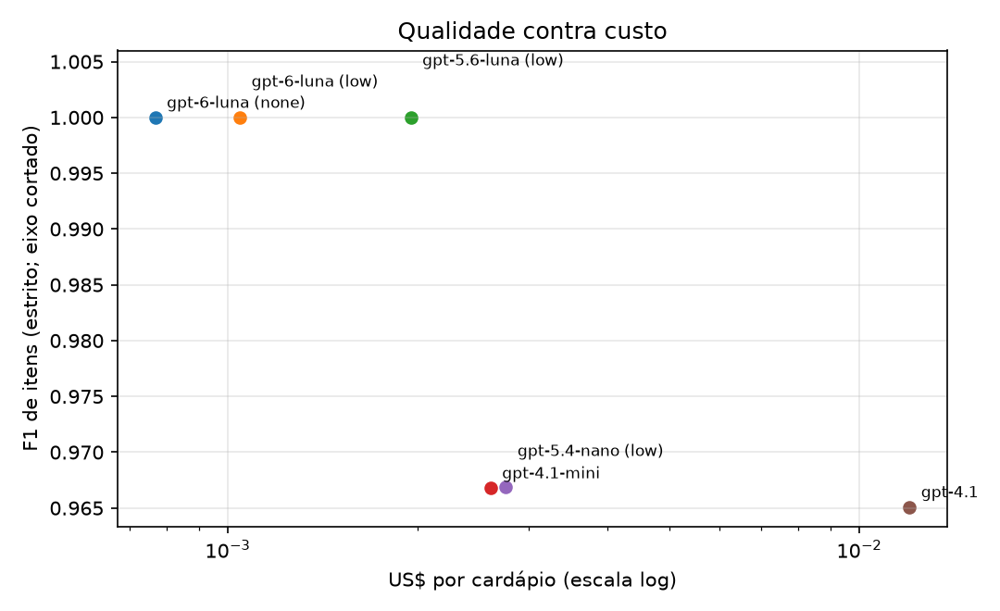

# Resultados

| Execução | Leitor | Menus | F1 de itens | F1 tolerante | Precisão | Revocação | Preço certo | Inventado | JSON válido | Tokens (entrada/saída) | US$ por cardápio | p50 / p95 (s) |
|---|---|---|---|---|---|---|---|---|---|---|---|---|
| openai-gpt-5.6-luna-low-high | openai `gpt-5.6-luna` | 10 | 1,0000 | 1,0000 | 1,0000 | 1,0000 | 1,0000 | 0,0000 | 1,0000 | 4765 / 830 | 0,00195 | 7,68 / 10,73 |
| openai-gpt-6-luna-low-high | openai `gpt-6-luna` | 10 | 1,0000 | 1,0000 | 1,0000 | 1,0000 | 1,0000 | 0,0000 | 1,0000 | 4765 / 1138 | 0,00105 | 11,84 / 16,23 |
| openai-gpt-6-luna-none-high | openai `gpt-6-luna` | 10 | 1,0000 | 1,0000 | 1,0000 | 1,0000 | 1,0000 | 0,0000 | 1,0000 | 4765 / 696 | 0,00077 | 5,75 / 9,19 |
| sanity-oracle | oracle `oracle` | 60 | 1,0000 | 1,0000 | 1,0000 | 1,0000 | 1,0000 | 0,0000 | 1,0000 | 0 / 0 | n/d | 0,00 / 0,00 |
| openai-gpt-5.4-nano-low-high | openai `gpt-5.4-nano` | 10 | 0,9669 | 0,9917 | 0,9710 | 0,9630 | 0,9701 | 0,0290 | 1,0000 | 4353 / 1511 | 0,00276 | 10,64 / 19,19 |
| openai-gpt-4.1-mini-high | openai `gpt-4.1-mini` | 10 | 0,9668 | 0,9917 | 0,9749 | 0,9588 | 1,0000 | 0,0251 | 1,0000 | 3796 / 681 | 0,00261 | 7,15 / 11,06 |
| openai-gpt-4.1-high | openai `gpt-4.1` | 10 | 0,9651 | 0,9856 | 0,9631 | 0,9671 | 0,9957 | 0,0369 | 1,0000 | 1908 / 1025 | 0,01202 | 6,54 / 10,01 |
| sanity-noise-10 | noisy `noisy` | 60 | 0,8787 | 0,8787 | 0,8999 | 0,8584 | 0,9037 | 0,1001 | 1,0000 | 0 / 0 | n/d | 0,00 / 0,00 |
| sanity-noise-30 | noisy `noisy` | 60 | 0,6557 | 0,6557 | 0,7390 | 0,5894 | 0,7076 | 0,2610 | 1,0000 | 0 / 0 | n/d | 0,00 / 0,00 |
| openai-gpt-4.1-nano-high | openai `gpt-4.1-nano` | 4 | 0,0000 | 0,0000 | 0,0000 | 0,0000 | 0,0000 | 0,0000 | 0,0000 | 0 / 0 | 0,00000 | 1,45 / 2,27 |

**openai-gpt-4.1-high**: F1 de itens por estilo de cardápio

| Estilo | Menus | F1 | F1 tolerante | Preço certo | Inventado |
|---|---|---|---|---|---|
| chalkboard | 1 | 1,0000 | 1,0000 | 1,0000 | 0,0000 |
| pdf_digital_2col | 1 | 1,0000 | 1,0000 | 1,0000 | 0,0000 |
| pdf_digital_clean | 1 | 1,0000 | 1,0000 | 1,0000 | 0,0000 |
| pdf_scan | 1 | 1,0000 | 1,0000 | 1,0000 | 0,0000 |
| photo_2col_serif | 1 | 1,0000 | 1,0000 | 1,0000 | 0,0000 |
| photo_blur | 1 | 0,8140 | 0,9302 | 1,0000 | 0,2045 |
| photo_lowlight | 1 | 1,0000 | 1,0000 | 1,0000 | 0,0000 |
| photo_multipage | 1 | 0,9804 | 0,9804 | 1,0000 | 0,0000 |
| photo_straight | 1 | 1,0000 | 1,0000 | 0,9524 | 0,0000 |
| screenshot_compact | 1 | 1,0000 | 1,0000 | 1,0000 | 0,0000 |

**openai-gpt-4.1-mini-high**: F1 de itens por estilo de cardápio

| Estilo | Menus | F1 | F1 tolerante | Preço certo | Inventado |
|---|---|---|---|---|---|
| chalkboard | 1 | 1,0000 | 1,0000 | 1,0000 | 0,0000 |
| pdf_digital_2col | 1 | 0,8889 | 0,8889 | 1,0000 | 0,0000 |
| pdf_digital_clean | 1 | 1,0000 | 1,0000 | 1,0000 | 0,0000 |
| pdf_scan | 1 | 1,0000 | 1,0000 | 1,0000 | 0,0000 |
| photo_2col_serif | 1 | 0,9545 | 1,0000 | 1,0000 | 0,0455 |
| photo_blur | 1 | 0,8810 | 1,0000 | 1,0000 | 0,1190 |
| photo_lowlight | 1 | 1,0000 | 1,0000 | 1,0000 | 0,0000 |
| photo_multipage | 1 | 1,0000 | 1,0000 | 1,0000 | 0,0000 |
| photo_straight | 1 | 1,0000 | 1,0000 | 1,0000 | 0,0000 |
| screenshot_compact | 1 | 1,0000 | 1,0000 | 1,0000 | 0,0000 |

**openai-gpt-4.1-nano-high**: F1 de itens por estilo de cardápio

| Estilo | Menus | F1 | F1 tolerante | Preço certo | Inventado |
|---|---|---|---|---|---|
| pdf_digital_2col | 1 | 0,0000 | 0,0000 | 0,0000 | 0,0000 |
| pdf_digital_clean | 1 | 0,0000 | 0,0000 | 0,0000 | 0,0000 |
| pdf_scan | 1 | 0,0000 | 0,0000 | 0,0000 | 0,0000 |
| photo_straight | 1 | 0,0000 | 0,0000 | 0,0000 | 0,0000 |

**openai-gpt-5.4-nano-low-high**: F1 de itens por estilo de cardápio

| Estilo | Menus | F1 | F1 tolerante | Preço certo | Inventado |
|---|---|---|---|---|---|
| chalkboard | 1 | 0,9565 | 0,9565 | 0,9394 | 0,0294 |
| pdf_digital_2col | 1 | 1,0000 | 1,0000 | 1,0000 | 0,0000 |
| pdf_digital_clean | 1 | 1,0000 | 1,0000 | 0,9286 | 0,0000 |
| pdf_scan | 1 | 1,0000 | 1,0000 | 1,0000 | 0,0000 |
| photo_2col_serif | 1 | 0,9302 | 0,9767 | 1,0000 | 0,0476 |
| photo_blur | 1 | 0,8810 | 1,0000 | 1,0000 | 0,1190 |
| photo_lowlight | 1 | 1,0000 | 1,0000 | 0,8125 | 0,0000 |
| photo_multipage | 1 | 1,0000 | 1,0000 | 1,0000 | 0,0000 |
| photo_straight | 1 | 1,0000 | 1,0000 | 1,0000 | 0,0000 |
| screenshot_compact | 1 | 1,0000 | 1,0000 | 0,9565 | 0,0000 |

**openai-gpt-5.6-luna-low-high**: F1 de itens por estilo de cardápio

| Estilo | Menus | F1 | F1 tolerante | Preço certo | Inventado |
|---|---|---|---|---|---|
| chalkboard | 1 | 1,0000 | 1,0000 | 1,0000 | 0,0000 |
| pdf_digital_2col | 1 | 1,0000 | 1,0000 | 1,0000 | 0,0000 |
| pdf_digital_clean | 1 | 1,0000 | 1,0000 | 1,0000 | 0,0000 |
| pdf_scan | 1 | 1,0000 | 1,0000 | 1,0000 | 0,0000 |
| photo_2col_serif | 1 | 1,0000 | 1,0000 | 1,0000 | 0,0000 |
| photo_blur | 1 | 1,0000 | 1,0000 | 1,0000 | 0,0000 |
| photo_lowlight | 1 | 1,0000 | 1,0000 | 1,0000 | 0,0000 |
| photo_multipage | 1 | 1,0000 | 1,0000 | 1,0000 | 0,0000 |
| photo_straight | 1 | 1,0000 | 1,0000 | 1,0000 | 0,0000 |
| screenshot_compact | 1 | 1,0000 | 1,0000 | 1,0000 | 0,0000 |

**openai-gpt-6-luna-low-high**: F1 de itens por estilo de cardápio

| Estilo | Menus | F1 | F1 tolerante | Preço certo | Inventado |
|---|---|---|---|---|---|
| chalkboard | 1 | 1,0000 | 1,0000 | 1,0000 | 0,0000 |
| pdf_digital_2col | 1 | 1,0000 | 1,0000 | 1,0000 | 0,0000 |
| pdf_digital_clean | 1 | 1,0000 | 1,0000 | 1,0000 | 0,0000 |
| pdf_scan | 1 | 1,0000 | 1,0000 | 1,0000 | 0,0000 |
| photo_2col_serif | 1 | 1,0000 | 1,0000 | 1,0000 | 0,0000 |
| photo_blur | 1 | 1,0000 | 1,0000 | 1,0000 | 0,0000 |
| photo_lowlight | 1 | 1,0000 | 1,0000 | 1,0000 | 0,0000 |
| photo_multipage | 1 | 1,0000 | 1,0000 | 1,0000 | 0,0000 |
| photo_straight | 1 | 1,0000 | 1,0000 | 1,0000 | 0,0000 |
| screenshot_compact | 1 | 1,0000 | 1,0000 | 1,0000 | 0,0000 |

**openai-gpt-6-luna-none-high**: F1 de itens por estilo de cardápio

| Estilo | Menus | F1 | F1 tolerante | Preço certo | Inventado |
|---|---|---|---|---|---|
| chalkboard | 1 | 1,0000 | 1,0000 | 1,0000 | 0,0000 |
| pdf_digital_2col | 1 | 1,0000 | 1,0000 | 1,0000 | 0,0000 |
| pdf_digital_clean | 1 | 1,0000 | 1,0000 | 1,0000 | 0,0000 |
| pdf_scan | 1 | 1,0000 | 1,0000 | 1,0000 | 0,0000 |
| photo_2col_serif | 1 | 1,0000 | 1,0000 | 1,0000 | 0,0000 |
| photo_blur | 1 | 1,0000 | 1,0000 | 1,0000 | 0,0000 |
| photo_lowlight | 1 | 1,0000 | 1,0000 | 1,0000 | 0,0000 |
| photo_multipage | 1 | 1,0000 | 1,0000 | 1,0000 | 0,0000 |
| photo_straight | 1 | 1,0000 | 1,0000 | 1,0000 | 0,0000 |
| screenshot_compact | 1 | 1,0000 | 1,0000 | 1,0000 | 0,0000 |

**sanity-noise-10**: F1 de itens por estilo de cardápio

| Estilo | Menus | F1 | F1 tolerante | Preço certo | Inventado |
|---|---|---|---|---|---|
| chalkboard | 6 | 0,8984 | 0,8984 | 0,8832 | 0,0680 |
| pdf_digital_2col | 6 | 0,8986 | 0,8986 | 0,8468 | 0,0534 |
| pdf_digital_clean | 6 | 0,8300 | 0,8300 | 0,9143 | 0,1393 |
| pdf_scan | 6 | 0,9030 | 0,9030 | 0,9141 | 0,0843 |
| photo_2col_serif | 6 | 0,8443 | 0,8443 | 0,8934 | 0,1469 |
| photo_blur | 6 | 0,8750 | 0,8750 | 0,9486 | 0,1206 |
| photo_lowlight | 6 | 0,8936 | 0,8936 | 0,8857 | 0,0948 |
| photo_multipage | 6 | 0,8827 | 0,8827 | 0,9021 | 0,1006 |
| photo_straight | 6 | 0,8652 | 0,8652 | 0,8852 | 0,1159 |
| screenshot_compact | 6 | 0,8862 | 0,8862 | 0,9375 | 0,0769 |

**sanity-noise-30**: F1 de itens por estilo de cardápio

| Estilo | Menus | F1 | F1 tolerante | Preço certo | Inventado |
|---|---|---|---|---|---|
| chalkboard | 6 | 0,5683 | 0,5683 | 0,5949 | 0,3417 |
| pdf_digital_2col | 6 | 0,6364 | 0,6364 | 0,7500 | 0,2941 |
| pdf_digital_clean | 6 | 0,6609 | 0,6609 | 0,7143 | 0,2451 |
| pdf_scan | 6 | 0,6954 | 0,6954 | 0,7168 | 0,2042 |
| photo_2col_serif | 6 | 0,6642 | 0,6642 | 0,8090 | 0,2705 |
| photo_blur | 6 | 0,6648 | 0,6648 | 0,6529 | 0,2577 |
| photo_lowlight | 6 | 0,6766 | 0,6766 | 0,7500 | 0,1707 |
| photo_multipage | 6 | 0,6826 | 0,6826 | 0,7000 | 0,2188 |
| photo_straight | 6 | 0,6442 | 0,6442 | 0,6977 | 0,3008 |
| screenshot_compact | 6 | 0,6581 | 0,6581 | 0,7087 | 0,2847 |

**sanity-oracle**: F1 de itens por estilo de cardápio

| Estilo | Menus | F1 | F1 tolerante | Preço certo | Inventado |
|---|---|---|---|---|---|
| chalkboard | 6 | 1,0000 | 1,0000 | 1,0000 | 0,0000 |
| pdf_digital_2col | 6 | 1,0000 | 1,0000 | 1,0000 | 0,0000 |
| pdf_digital_clean | 6 | 1,0000 | 1,0000 | 1,0000 | 0,0000 |
| pdf_scan | 6 | 1,0000 | 1,0000 | 1,0000 | 0,0000 |
| photo_2col_serif | 6 | 1,0000 | 1,0000 | 1,0000 | 0,0000 |
| photo_blur | 6 | 1,0000 | 1,0000 | 1,0000 | 0,0000 |
| photo_lowlight | 6 | 1,0000 | 1,0000 | 1,0000 | 0,0000 |
| photo_multipage | 6 | 1,0000 | 1,0000 | 1,0000 | 0,0000 |
| photo_straight | 6 | 1,0000 | 1,0000 | 1,0000 | 0,0000 |
| screenshot_compact | 6 | 1,0000 | 1,0000 | 1,0000 | 0,0000 |

